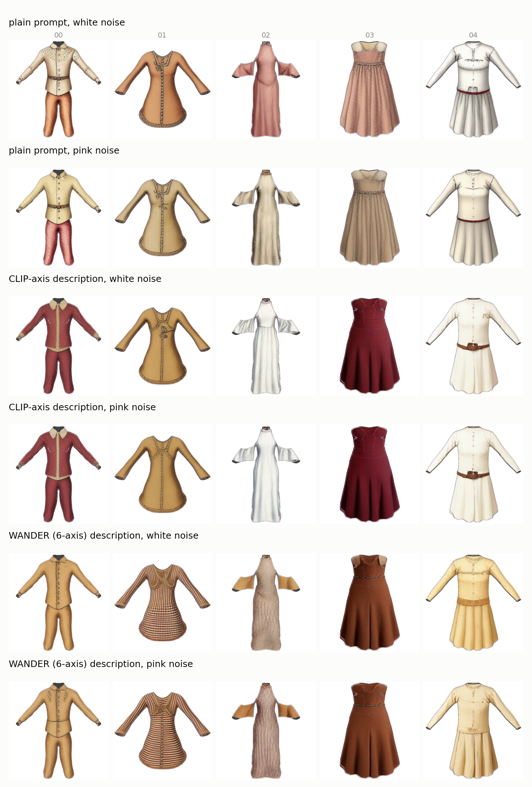
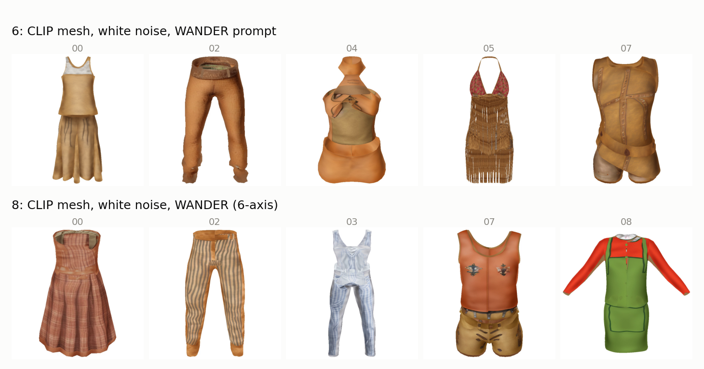
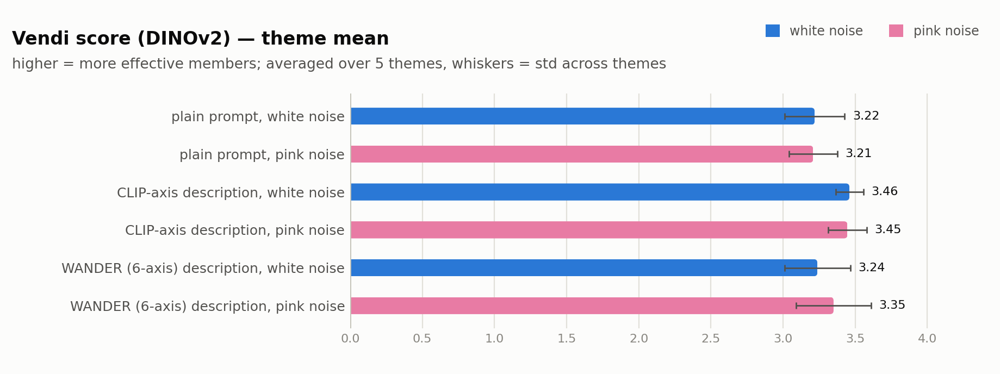

# LatentWardrobe

**Diversity-aware diffusion texturing for 3D crowds.** Given a single theme
prompt (e.g. *"medieval villagers"*), LatentWardrobe generates a crowd of
textured 3D garment meshes that stay on-theme while remaining perceptually
diverse — no two members should read as clones.

MSc dissertation project, Trinity College Dublin, supervised by Rachel McDonnell.


*The mesh-fixed comparison: every column is the same garment mesh and
diffusion seed; rows differ only in texturing method (prompt strategy ×
initial noise). Reading down a column shows exactly — and only — what each
method changes.*

## Motivation

Texture-diffusion pipelines such as Paint3D (Zeng et al., CVPR 2024) can paint
a garment mesh from a text prompt, but conditional diffusion models
systematically under-deliver diversity when sampled repeatedly under the same
conditioning: a naively generated crowd collapses toward near-duplicate
outfits. Perceptual crowd research (McDonnell et al., *Clone Attack!*,
SIGGRAPH 2008) shows viewers reliably detect such appearance clones, and that
clothing colour/texture variation is precisely what masks them. This project
studies training-free interventions that restore appearance diversity without
sacrificing theme coherence.

## Method

Each crowd member is an outfit (top + bottom, or fullbody garment) drawn from
a 139-piece CC0 MakeHuman mesh library and textured by Paint3D
(Stable Diffusion 1.5 + depth ControlNet). Interventions are applied at three
independent points and compared factorially:

| Factor | Levels |
|---|---|
| Garment mesh selection | uniform random · CLIP-similarity to theme (softmax, τ) |
| Initial latent noise | white · pink (FFT reweight `1/(1+f)^α`, α = 0.2; Harrington et al., CVPR 2026) |
| Per-member prompt | plain theme · CLIP-sampled 6-axis clothing description · LLM-evolved description |

CLIP mesh selection additionally draws outfits *pair-coherently*: one slot
(top or bottom, random which) is sampled first against the theme, then the
other slot's weights are re-weighted by CLIP image–image similarity to the
chosen garment (softmax, τ_pair) — independent per-slot draws can pair a top
and bottom that each fit the theme but not each other. The uniform-random
baseline keeps truly independent draws.

The LLM prompt method is a WANDER-inspired novelty search (arXiv 2511.00686):
a local llama-3.1-8B evolves a population of structured clothing descriptions
(colour / formality / material / pattern / condition / accessories), accepting
mutations only when they increase k-NN novelty in CLIP text space. Each
member's evolved description also becomes the CLIP anchor for its own mesh
selection, coupling prompt content to silhouette choice. An earlier 12-axis
variant that scored novelty on the full wearer description converged to a
near-monochrome crowd — an instructive failure documented in
`scripts/llm_prompt_mutation.py`; the corrected 6-axis, clothing-novelty
search is the study's best-performing method:


*Same theme, same pipeline: the initial search optimised text the renderer
cannot see (top); restricting evolution to renderable clothing attributes
recovers colour and pattern diversity (bottom).*

## Evaluation

Evaluation separates three questions, each with its own generation batch,
metrics file, and chart folder:

1. **Mesh selection** (`plots/mesh/`, `shape_metrics.json`) — what does
   sampling alone change? Untextured, grey-shaded turntables of the
   end-to-end batch, scored with the perceptual battery minus colour and
   CLIPScore (meaningless without paint) plus pairwise silhouette 1−IoU on
   the camera-aligned foreground masks — a pure-geometry diversity number
   with no pretrained model in the loop.
2. **Texture generation** (`plots/texture/`, mesh-fixed batch) — what do
   prompt strategy and noise change when the meshes can't? Every texturing
   method replayed against one shared set of garment meshes and diffusion
   seeds, pinned per member index from the CLIP-mesh reference cell
   (`--fixed-members-from`).
3. **End-to-end** (`plots/end_to_end/`) — meshes and textures both vary; the
   as-deployed comparison.

The appearance battery follows Harrington et al. — patchwise DINOv2 distance,
DreamSim, LPIPS, low-resolution pixel L2, hue-histogram χ², and Vendi/DPP
scores over a DINOv2 kernel — alongside CLIPScore theme coherence, since
diversity is trivial if the crowd may drift off-theme. All metrics are
computed on foreground-masked turntable renders; each chart is emitted both
per-theme and averaged across themes (`per_prompt/` and `avg/` subfolders),
plus per-theme contact sheets. Current batches generate stage 1 only (~1/9
the per-member cost of full two-stage texturing); colour diversity on these
uses a painted-texel mask derived from Paint3D's exact placeholder colour,
flagged `color_source: "stage1_derived_mask"` in `metrics.json`.



Headline results on the five-theme crowd library (N = 5 per crowd, theme
means; batch `crowd_library_20260715`):

- **Texture stage (mesh-fixed):** with meshes and seeds pinned, CLIP-axis
  description sampling is the strongest texturing diversifier — Vendi
  3.46/3.45 (white/pink) vs 3.22 for the plain prompt, colour χ²
  0.745/0.758 vs 0.596, DreamSim agreeing (0.52 vs 0.47). WANDER (6-axis)
  trades diversity for perceived quality: best HPSv2 (0.135) and the
  stage's best CLIPScore coherence (0.210).
- **End-to-end:** set-level diversity compresses (Vendi 3.08–3.22) as mesh
  selection partially masks texturing gains, but the method signatures
  persist — axes lead colour (0.729/0.707), WANDER leads quality (HPSv2
  0.142/0.141) and coherence (CLIPScore 0.216/0.213). Coherence is
  otherwise flat (0.206–0.211): no method pays for diversity with theme
  drift.
- **Mesh stage:** CLIP-anchored selection *costs* silhouette diversity
  relative to random selection (shape Vendi 2.35–2.58 vs 2.80; silhouette
  1−IoU 0.54–0.58 vs 0.60) — the expected coherence↔diversity trade-off
  made measurable — while CLIPScore on untextured renders (0.190–0.193) is
  too weak an instrument to resolve the coherence side; mesh-level theme
  fit reads qualitatively in the contact sheets instead.
- **Pink noise** nudges colour diversity on plain prompts (χ² 0.630 vs
  0.596) and washes out under description-driven prompting, at no
  set-level cost.

Charts for all three stages (per-theme and theme-averaged) and per-theme
contact sheets live under
`outputs/crowd_library_20260715_stage1eval/plots/{mesh,texture,end_to_end}/`.
An earlier single-theme pilot (full two-stage texturing, N = 10, pre
pool-fix) is preserved in `outputs/factorial7_20260706/`, with cross-theme
replication in `outputs/multitheme_20260710/`.

## Repository layout

```
scripts/
  generate_crowd_baseline.py   crowd generation driver (all methods, manifests, resume)
  mesh_sampling.py             CLIP-anchored garment mesh selection (+ pair-coherent outfits)
  pink_noise.py                pink-noise initial-latent patch
  llm_prompt_mutation.py       WANDER-inspired LLM novelty search (Ollama)
  evaluate_crowd.py            appearance diversity + coherence battery
  evaluate_shape.py            shape-only battery (+ silhouette IoU)
  generate_shape_eval.py       untextured turntable renders for the shape eval
  plot_crowd_comparison.py     per-metric bar charts (per-theme + theme-mean)
  plot_crowd_contact_sheet.py  member-grid contact sheets
  run_crowd_library*.sh        active experiment: end-to-end + mesh-fixed generation,
                               3 eval passes, plots, supervisor, pipeline watcher
  run_factorial7*.sh           medieval-villagers factorial (historical)
  run_multitheme*.sh           cross-theme replication (historical)
assets/meshes/                 139 CC0 garment meshes (MakeHuman-derived)
assets/meshes_removed/         meshes excluded from the pool (broken UV/texturing)
external/paint3d/              Paint3D (git submodule)
outputs/<batch>/<cell>/<prompt>/          manifests, metrics.json, renders
outputs/<batch>/plots/{mesh,texture,end_to_end}/{avg,per_prompt}/  stage-grouped charts
```

Generation runs inside WSL2 (`paint3d` conda env); evaluation runs in a
separate `eval` env (`.claude/setup/`). Every crowd records a manifest of
seeds, garments, and prompts; LLM evolution — the one non-reproducible
component — persists its full population and mutation history alongside.

## Key references

- Zeng et al., *Paint3D: Paint Anything 3D with Lighting-less Texture Diffusion Models*, CVPR 2024
- McDonnell et al., *Clone Attack! Perception of Crowd Variety*, SIGGRAPH 2008
- Harrington et al., *It's Never Too Late: Noise Optimization for Collapse Recovery in Trained Diffusion Models*, CVPR 2026
- *WANDER — Evolve to Inspire: Novelty Search for Diverse Image Generation*, arXiv 2511.00686
- Friedman & Dieng, *The Vendi Score: A Diversity Evaluation Metric for Machine Learning*, TMLR 2023
- Kulesza & Taskar, *k-DPPs: Fixed-Size Determinantal Point Processes*, ICML 2011

A fuller annotated review (31 papers, verification status per entry) is in
`.claude/lit-review-diffusion-diversity.md`.
