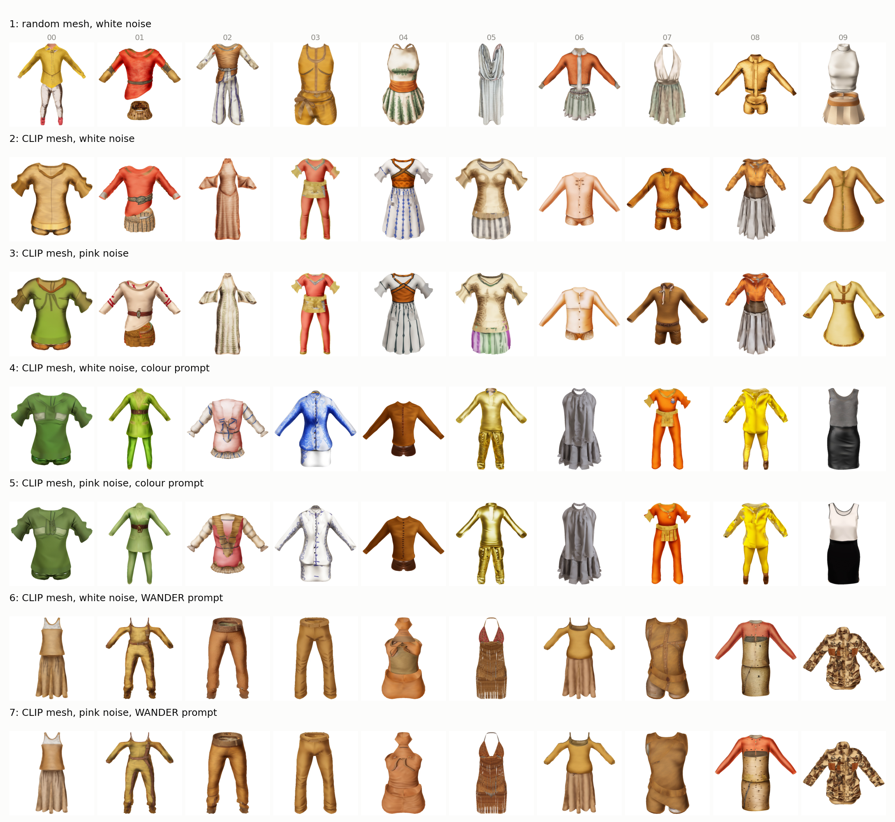

# LatentWardrobe

**Diversity-aware diffusion texturing for 3D crowds.** Given a single theme
prompt (e.g. *"medieval villagers"*), LatentWardrobe generates a crowd of
textured 3D garment meshes that stay on-theme while remaining perceptually
diverse — no two members should read as clones.

MSc dissertation project, Trinity College Dublin, supervised by Rachel McDonnell.


*One row per method, five sampled members per row, all generated from the same
theme prompt.*

## Motivation

Texture-diffusion pipelines such as Paint3D (Zeng et al., CVPR 2024) can paint
a garment mesh from a text prompt, but conditional diffusion models
systematically under-deliver diversity when sampled repeatedly under the same
conditioning: a naively generated crowd collapses toward near-duplicate
outfits. Perceptual crowd research (McDonnell et al., *Clone Attack!*,
SIGGRAPH 2008) shows viewers reliably detect such appearance clones, and that
clothing colour/texture variation is precisely what masks them. This project
studies training-free interventions that restore appearance diversity without
sacrificing theme coherence.

## Method

Each crowd member is an outfit (top + bottom, or fullbody garment) drawn from
a 143-piece CC0 MakeHuman mesh library and textured by Paint3D
(Stable Diffusion 1.5 + depth ControlNet) in two stages. Interventions are
applied at three independent points and compared factorially:

| Factor | Levels |
|---|---|
| Garment mesh selection | uniform random · CLIP-similarity to theme (softmax, τ) |
| Initial latent noise | white · pink (FFT reweight `1/(1+f)^α`, α = 0.2; Harrington et al., CVPR 2026) |
| Per-member prompt | plain theme · + random colour word · LLM-evolved description |

The LLM prompt method is a WANDER-inspired novelty search (arXiv 2511.00686):
a local llama-3.1-8B evolves a population of structured clothing descriptions
(colour / formality / material / pattern / condition / accessories), accepting
mutations only when they increase k-NN novelty in CLIP text space. Each
member's evolved description also becomes the CLIP anchor for its own mesh
selection, coupling prompt content to silhouette choice. An earlier 12-axis
variant that scored novelty on the full wearer description converged to a
near-monochrome crowd — an instructive failure documented in
`scripts/llm_prompt_mutation.py`; the corrected 6-axis, clothing-novelty
search is the study's best-performing method:


*Same theme, same pipeline: the initial search optimised text the renderer
cannot see (top); restricting evolution to renderable clothing attributes
recovers colour and pattern diversity (bottom).*

## Evaluation

Crowds are scored on foreground-masked turntable renders with a diversity
battery following Harrington et al. — patchwise DINOv2 distance, DreamSim,
LPIPS, low-resolution pixel L2, hue-histogram χ², and Vendi/DPP scores over a
DINOv2 kernel — alongside CLIPScore theme coherence, since diversity is
trivial if the crowd may drift off-theme.


Headline results on the `medieval villagers` factorial (N = 10 per cell):
theme coherence is flat across all methods (0.19–0.21), so diversity gains
were not paid for with theme drift; a single random colour word triples colour
diversity (χ² 0.53 → 0.86); and the corrected 6-axis LLM search achieves the
study's highest effective-member count (Vendi 5.01 vs 4.73 for the random-mesh
baseline) while more than doubling the colour diversity of its 12-axis
predecessor. A cross-theme replication (superheroes, business formalwear) is
in `outputs/multitheme_20260710/`.

## Repository layout

```
scripts/
  generate_crowd_baseline.py   crowd generation driver (all methods, manifests, resume)
  mesh_sampling.py             CLIP-anchored garment mesh selection
  pink_noise.py                pink-noise initial-latent patch
  llm_prompt_mutation.py       WANDER-inspired LLM novelty search (Ollama)
  evaluate_crowd.py            diversity + coherence metric battery
  plot_crowd_comparison.py     per-metric bar charts across methods
  plot_crowd_contact_sheet.py  member-grid contact sheets
  run_factorial7*.sh           medieval-villagers factorial batch + supervisor + eval
  run_multitheme*.sh           cross-theme replication batch
assets/meshes/                 143 CC0 garment meshes (MakeHuman-derived)
external/paint3d/              Paint3D (git submodule)
outputs/<batch>/<cell>/<prompt>/   manifests, metrics.json, renders, plots
```

Generation runs inside WSL2 (`paint3d` conda env); evaluation runs in a
separate `eval` env (`.claude/setup/`). Every crowd records a manifest of
seeds, garments, and prompts; LLM evolution — the one non-reproducible
component — persists its full population and mutation history alongside.

## Key references

- Zeng et al., *Paint3D: Paint Anything 3D with Lighting-less Texture Diffusion Models*, CVPR 2024
- McDonnell et al., *Clone Attack! Perception of Crowd Variety*, SIGGRAPH 2008
- Harrington et al., *It's Never Too Late: Noise Optimization for Collapse Recovery in Trained Diffusion Models*, CVPR 2026
- *WANDER — Evolve to Inspire: Novelty Search for Diverse Image Generation*, arXiv 2511.00686
- Friedman & Dieng, *The Vendi Score: A Diversity Evaluation Metric for Machine Learning*, TMLR 2023
- Kulesza & Taskar, *k-DPPs: Fixed-Size Determinantal Point Processes*, ICML 2011

A fuller annotated review (31 papers, verification status per entry) is in
`.claude/lit-review-diffusion-diversity.md`.
